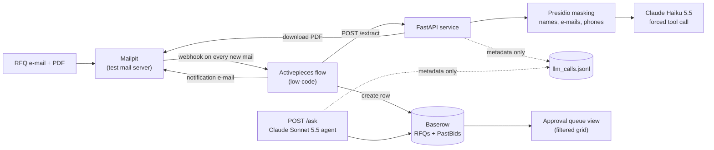

# Low-Code Request for Quotation (RFQ) Automation with AI Agents

Fictional company: **Nordwind Turbine Services**. Every customer, site, person, e-mail address, phone number and bid in this repo is invented.

## The problem

Requests for quotation (RFQs) arrive as e-mails with a PDF attached. Someone opens each one, retypes the customer, site, equipment, service type and due date into a tracker, notices what is missing, and tells the bid manager. It is slow, error-prone and nobody can see what is waiting for a decision.

**BidDesk**, the app in this repo, automates the retyping and keeps the decision with a person:

1. An RFQ e-mail arrives.
2. A no-code flow picks it up, sends the PDF through an AI extraction step, and writes a row to a table with status **Awaiting approval**.
3. The bid manager gets a notification e-mail and works through a filtered **Approval queue** view.
4. Anyone on the bid team can ask questions of the past-bid history in plain language (`/ask`), with every answer citing bid ids.

## Architecture



## What is low-code here

Most of the business logic is configured, not coded:

| Piece | Tool | What you configure |
|---|---|---|
| The intake flow | **Activepieces** (open-source automation) | A 5-step flow: Catch Webhook -> Router (subject starts with "RFQ") -> HTTP request -> Create Baserow row -> Send e-mail. Exported to [`activepieces/biddesk_flow.json`](activepieces/biddesk_flow.json). |
| The data model | **Baserow** (open-source no-code database) | Two tables with typed fields: `RFQs` (single-select status, date-time, long text) and `PastBids` (single selects for equipment, service type, price band and outcome). Created by a script, editable in the UI. |
| The approval queue | Baserow view | A Grid view named "Approval queue" filtered on `status = Awaiting approval`. The bid manager approves by changing the status and typing their name into `approved_by`. |
| Notifications | Activepieces SMTP step | E-mail to the bid manager with customer, site, equipment, service, due date and what is missing. |

A business user can change the Router condition, the target table, the field mapping or the e-mail text without touching Python. See the [citizen developer guide](docs/citizen-developer-guide.md).

## The code parts

Only the parts that need real code are code:

- **`POST /extract`** (`app/extract.py`): downloads the PDF from Mailpit, extracts the text, masks personal data, asks Claude Haiku 5.5 for a structured result through a forced tool call, validates it with Pydantic and returns the fields plus `model`, `prompt_version` and `extracted_at`. If the mail has no PDF it returns `{"skipped": true, "reason": "no pdf"}`. Instructions to the model: do not guess; null plus `missing_info` when a detail is not in the text.
- **PII masking** (`app/masking.py`): Presidio masks `PERSON`, `EMAIL_ADDRESS` and `PHONE_NUMBER` before anything leaves for the model. Customer, site and unit names come from an allow-list (`data/allowlist.json`) so they are not mistaken for people. Entity counts are logged, the values never are.
- **`POST /ask`** (`app/agent.py`): a Claude Sonnet 5.5 agent with two tools, `search_past_bids` and `get_rfq`, that reads Baserow. It answers only from tool results, cites `bid_id`s, says so when nothing matches and never invents prices (the data only has price bands). Cited ids are checked against what the tools actually returned.
- **Audit log** (`logs/llm_calls.jsonl`, via `app/logging_utils.py`): one line per model call with model, prompt version, latency, tokens, masked-entity counts and tools used. No question, answer or document text.

See [docs/governance.md](docs/governance.md) for the controls and what production would still need.

## Quick start

Needs Docker Desktop, Python 3.12+ and an Anthropic API key.

```powershell
git clone https://github.com/KeertiPremGadde/low-code-rfq-automation-with-ai-agents.git biddesk
cd biddesk
python scripts\init_env.py      # creates .env (add your ANTHROPIC_API_KEY)
docker compose up -d            # Mailpit, Baserow, Activepieces
```

Full setup (Python environment, Baserow tables, importing the flow): [docs/SETUP.md](docs/SETUP.md).

## Demo walkthrough

```powershell
python scripts\send_rfq.py rfq_01      # one RFQ; or --all for all 20
```

1. **Mailpit** (http://localhost:8025): the RFQ mail with its PDF.
2. **Activepieces** (http://localhost:8080): the flow run, step by step.
3. **Baserow** (`Approval queue` view): a new row with status `Awaiting approval`, extracted fields and `missing_info`.
4. **Mailpit** again: the notification e-mail to the bid manager.
5. Change the row's status to `Approved` and fill `approved_by`; it leaves the queue.
6. Ask the history questions:
   ```powershell
   python scripts\ask_demo.py
   ```
   Five questions: wins by equipment and service, a price question that must not invent exact prices, a "nothing found" case, and two comparisons of real RFQ rows with similar past bids.

### What it looks like


*The five-step Activepieces flow.*


*The approval queue: a Baserow grid view filtered on status = Awaiting approval.*


*Mailpit inbox: incoming RFQ mails with their PDF attachments, and the notification mails the flow sent to the bid manager.*


*The notification e-mail: extracted fields and what is missing (here the site).*

Output of `python scripts\ask_demo.py` for one of the five questions. The agent says only price bands are recorded, and cites only bid ids the tools returned:

```text
==============================================================================
Q2: Which compressor upgrades have we bid on? Give the outcome and the exact EUR price of each.
------------------------------------------------------------------------------
We have bid on three compressor upgrades. The records hold only a price band for each bid, not an
exact price, so I can't give exact EUR prices.

| Bid | Customer | Scope | Price band | Outcome |
|---|---|---|---|---|
| NTS-B-2023-001 | Corvane District Heating | NW-C12 axial air compressor: anti-surge control upgrade and vibration monitoring retrofit | 50–150k EUR | Lost |
| NTS-B-2023-003 | Corvane District Heating | NW-C12 axial air compressor: anti-surge control upgrade and vibration monitoring retrofit | 500k–1M EUR | Lost |
| NTS-B-2025-003 | Piraeus Offshore Services | NW-C12 axial air compressor: re-rate to a new duty point with new impellers | >1M EUR | Lost |

All three were lost.

NTS-B-2023-001 and NTS-B-2023-003 have the same customer and scope but very different price bands.

Cited bid_ids: NTS-B-2023-001, NTS-B-2023-003, NTS-B-2025-003
Tools used:    search_past_bids

```

## Evaluation

`python scripts\eval.py` runs the extraction on the 20 PDFs (masking on) and compares with `data/answer_key.json`. Results from the last run (`claude-haiku-5-5`, prompt `extract-v1`, full report in [docs/eval_results.md](docs/eval_results.md)):

| Field | Score | Detail |
|---|---|---|
| customer | 100% | 20/20 exact |
| site | 100% | 20/20 exact |
| equipment_type | 100% | 20/20 exact |
| service_type | 100% | 20/20 exact |
| due_date | 100% | 20/20 exact |
| missing_info | 100% | per-file F1; micro precision 1.00, recall 1.00 |
| scope_summary | 95% | keyword overlap with answer key |
| **overall** | **99%** | mean of the 7 fields |

35,696 input and 5,388 output tokens for the 20 documents, about $0.006 at list price. These documents are clean, synthetic and generated from the same templates as the answer key, so the numbers show the pipeline works, not how it would score on real-world RFQs.

## Known limitations

- **The approval queue is a filtered Grid, not a Kanban board**, because Kanban is a paid Baserow feature. Approval is a manual status change; `approved_by` is free text and nothing enforces who may approve.
- **Local, throwaway logins and secrets.** The Baserow admin account and the demo credentials are for a laptop only. The FastAPI service has no authentication.
- **The flow does not check `skipped`.** The Router only lets subjects starting with "RFQ" through. A mail with an "RFQ" subject but no PDF would still create an empty row.
- **Mailpit is a test mail server** (no IMAP, nothing is sent outside). A real deployment needs a real mailbox connector.
- **One PDF per mail, text PDFs only**: no scanned documents or OCR.
- **Masking is limited on purpose** to names, e-mail addresses and phone numbers. Addresses, free-text identifiers and anything unusual are not masked.
- **Synthetic data**: accuracy on real documents is untested.

## Next steps

- An approval app in Appsmith on top of the `RFQs` table (the container is already in `docker-compose.yml`).
- Let the flow stop on `skipped`, and enforce who may approve.

## Repository layout

```
app/            FastAPI service: main, extract, agent, masking, llm, baserow, mailpit, schemas, logging_utils
scripts/        init_env, check_stack, generate_data, setup_baserow, send_rfq, eval, ask_demo
activepieces/   biddesk_flow.json (sanitised flow export)
data/           20 RFQ PDFs, past_bids.csv, answer_key.json, allowlist.json (all synthetic)
docs/           SETUP.md, citizen-developer-guide.md, governance.md, eval_results.md
docker-compose.yml   Mailpit, Baserow, Activepieces (+ Postgres, Redis)
```
